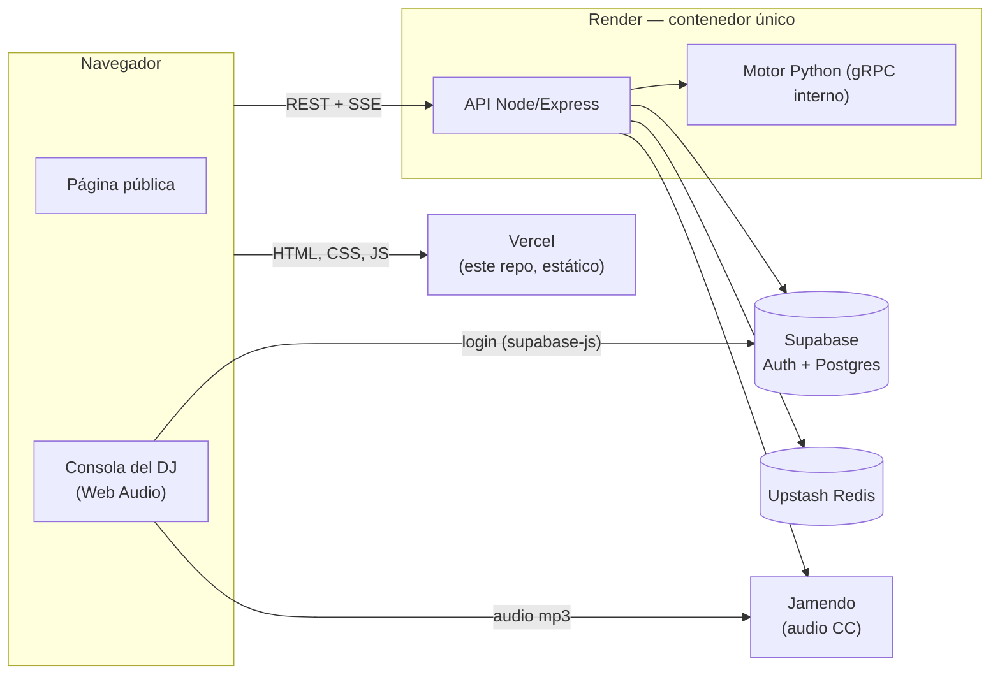

# SmartDJ — frontend

Sitio estático de SmartDJ (HTML, CSS y JavaScript nativo, sin build). Tiene tres partes:
- **Página pública** de cada local (`/?venue=<código>`, desde el link o el QR): el público ve qué suena y pide canciones sin cuenta.
- **Panel del dueño**: sus locales, el link y el QR de cada uno.
- **Consola de DJ**: la emisora del local suena en el navegador del dueño, con dos decks, crossfade, EQ y AutoDJ.

La API, el motor de IA y la base de datos están en [`smartdj-backend`](https://github.com/Pipemora1324/smartdj-backend).

## Arquitectura



- El navegador **solo** habla con la API por REST y SSE. Además:
  - Habla con Supabase Auth para iniciar sesión, con `supabase-js` por CDN con SRI.
  - Descarga el audio de Jamendo en la consola.
- Nunca llama a otras APIs externas: las búsquedas pasan por el backend.
- No usa gRPC: lo usa el backend con el motor.

| Archivo | Qué tiene |
| --- | --- |
| `index.html` | Página única; carga los scripts en orden: `theme-init.js` (en el `<head>`), `config.js`, `ui-core.js`, `app.js`, `ui.js`, `console-core.js` y `dj-console.js` |
| `config.js` | URL del backend y datos públicos de Supabase |
| `app.js` | Sesión, API, vistas: portada, panel y página pública |
| `ui-core.js` / `ui.js` | Lógica pura de la interfaz (tema, contraseña, header, código) y sus componentes |
| `console-core.js` / `dj-console.js` | Lógica pura de la consola (crossfade, forma de onda, cola) y la consola con Web Audio |
| `styles.css` | Sistema de diseño con tokens, temas claro y oscuro |

## Flujos

**Público** (`/?venue=<código>`):
1. Ve "Sonando ahora", con crédito y licencia, y las próximas canciones. Se actualiza por SSE (`/api/public/venues/:code/events`) y, si el SSE no conecta, consulta `/now` cada 10 s.
2. Busca (400 ms después de dejar de escribir). Primero salen canciones **Completa** (Jamendo) y, si hay pocas, **Preview 30 s** (iTunes).
3. Al tocar una canción la pide. El análisis del motor llega en vivo por SSE (`/api/public/requests/:id/events`), o cada 2 s si el SSE falla.
4. "Tus peticiones" muestra el estado de las suyas. Solo se guardan sus ids en el navegador.
5. La página pública no reproduce audio.

**Dueño:**
1. Se registra o entra con Supabase Auth (código de 6 dígitos por correo).
2. En el panel crea locales y comparte su link o QR. El QR se genera en el navegador y se descarga en PNG.
3. Abre la **Consola de DJ** en el equipo conectado al sonido y toca "Iniciar emisora", porque los navegadores no reproducen audio sin un clic.
   - En **AutoDJ**, la siguiente pista se precarga y el crossfade empieza donde sugiere el motor.
   - En **Manual** decide el dueño.
   - Pestañas: Cola (reordenable), Peticiones (reproducir ahora, añadir o descartar) y Buscar (catálogo de Jamendo).
   - Una pista que no carga se reintenta, después pasa al servidor de respaldo sin EQ y, si tampoco carga, se salta.
4. Solo una consola controla la emisora a la vez. Si otra toma el control, esta se pausa y lo avisa.

**Identificador del navegador:**
- Cada navegador guarda un identificador anónimo (`smartdj-client-id`) y lo envía como `X-Client-Id`, o `?client=` en los SSE, porque EventSource no manda cabeceras.
- Sirve para que los límites de uso del backend cuenten por celular y no por la IP del Wi-Fi del local, que comparten todos.
- No es un dato personal ni da permisos.

## Ejecutar en local

Requiere Node.js 18 o superior y el backend corriendo en `http://localhost:3000` (ver su README).

```bash
node scripts/dev-static-server.mjs 5173
```

Abre `http://localhost:5173`. Usa el puerto 5173, 3000 u 8080, que son los que el backend permite por CORS en local.

## Configuración (no hay variables de entorno)

El sitio es estático: la configuración vive en `config.js` y es **pública por diseño**.

| Valor | Uso |
| --- | --- |
| `window.SMARTDJ_API_URL` | URL del backend. Si no se define: `http://localhost:3000` en local (localhost, 127.0.0.1 y redes privadas 10/8, 172.16/12 y 192.168/16) y `https://smart-dj-platform.onrender.com` en producción. También se puede fijar con `<meta name="smartdj-api-url" content="…">`. |
| `window.SMARTDJ_SUPABASE_URL` | `https://<ref>.supabase.co` |
| `window.SMARTDJ_SUPABASE_ANON_KEY` | La clave **anon/publishable**. **Nunca** la `service_role` ni una `sb_secret_…` |

La configuración del panel de Supabase (SMTP, plantillas con el código y límites) está en `SUPABASE_AUTH.md` del backend.

## Pruebas, lint y formato

```bash
npm install          # solo herramientas de desarrollo; el sitio no tiene build
npm test             # pruebas unitarias (sin navegador)
npm run coverage     # con cobertura de los módulos lógicos
npm run lint         # ESLint; los globales compartidos entre scripts se leen de los propios archivos
npm run format       # Prettier (index.html y los .md quedan fuera, ver .prettierignore)
PLAYWRIGHT_MODULE=<ruta a node_modules/playwright> node scripts/smoke.e2e.mjs   # prueba de humo
```

- **Unitarias** (`scripts/*.test.mjs`, 36 pruebas):
  - Interfaz: tema, contraseña, header según la sesión, menú, código de 6 dígitos.
  - Consola: crossfade, transición y cola.
  - Datos y API: peticiones guardadas, `apiUrl()`, identificador del navegador y `liveUrl()`, y la elección de backend de `config.js`.
- **Cobertura:** `console-core.js` y `ui-core.js` al 100 % de líneas.
- **Prueba de humo:** recorre portada, menú móvil, registro, código, panel, consola y página pública, en tema claro y oscuro, a 360 y 1280 px.
  - Falla si hay errores en la consola o scroll horizontal.
  - Es autocontenida: responde el API con datos de prueba y usa dobles de Supabase y de los CDN.
  - Necesita Playwright: `npx -y playwright@1.49.1 install chromium`.
- Ninguna prueba usa el backend de producción ni el Supabase real.

## Despliegue

**Vercel**, como sitio estático sin build:
- `.vercelignore` deja fuera `package.json`, las herramientas y `scripts/`, así Vercel publica solo los archivos del sitio y no instala nada.
- No hace falta configurar variables.
- Si el dominio de Vercel cambia, hay que agregarlo a `CORS_ORIGIN` en Render.

**Docker** (opcional, nginx sin root en el puerto 8080; copia solo los archivos públicos):

```bash
docker build -t smartdj-frontend .
docker run -p 5173:8080 smartdj-frontend
```

## Seguridad, diseño y accesibilidad

- **Seguridad:**
  - Todo dato externo (servidor, URL o usuario) se inserta con `textContent`, nunca con `innerHTML`.
  - `apiUrl()` impide que una petición salga de `API_BASE/api/`.
  - Las librerías por CDN van con versión fija y SRI.
- **Diseño:**
  - Colores, tipografía, espacios, radios, sombras y duraciones salen de tokens en `:root`.
  - Temas claro y oscuro: sigue al sistema y se puede elegir con un botón; `theme-init.js` evita el parpadeo.
  - Contraste WCAG AA en ambos temas.
  - Las animaciones solo usan `transform` y `opacity`, y se desactivan con `prefers-reduced-motion`.
- **Accesibilidad:**
  - Foco visible y enlace "Saltar al contenido".
  - Etiquetas y errores asociados en los formularios.
  - Roles ARIA en el menú, las pestañas y los diálogos.
  - Objetivos táctiles de al menos 44 px.
  - Sin scroll horizontal de 320 a 1280 px.

## Licencias

- **Código:** proyecto académico, sin una licencia de software publicada; consulta al autor antes de reutilizarlo.
- **Librerías por CDN:** `supabase-js` (MIT) y `qrcode-generator` (MIT).
- **Música:** las condiciones de Jamendo (uso no comercial, crédito y enlace) y por qué los previews de iTunes no sirven para un uso real están en el README del backend.
